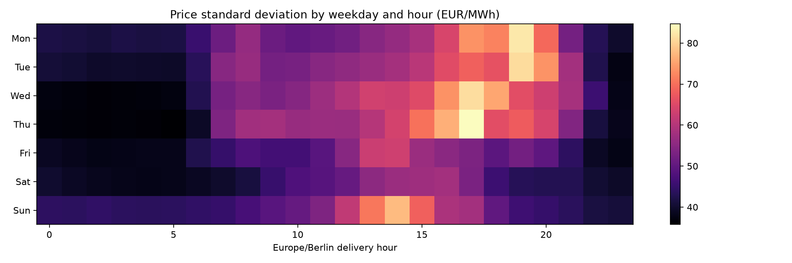
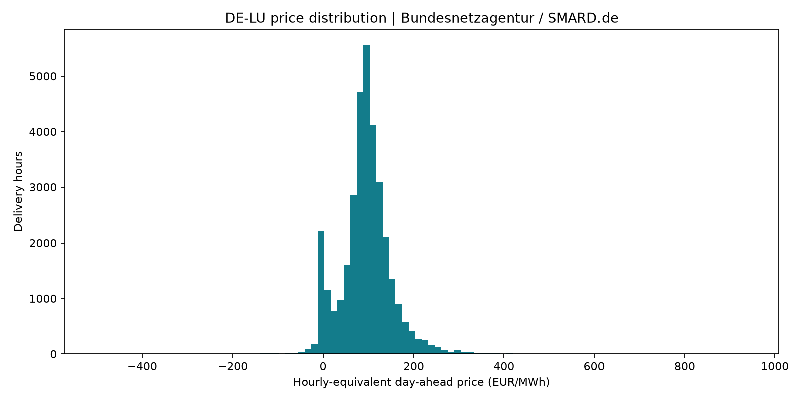

# European Power Market Volatility & Risk Analytics

**German electricity market · free public data · reproducible Python research**

Electricity procurement and generation exposures depend on delivery-hour price tails,
negative-price episodes and persistent volatility—not just average prices. This project
turns official German day-ahead observations into auditable historical risk reports and
hypothetical commercial exposure scenarios. Total data budget: **€0**. All calculations
run locally; no subscription, cloud service or private position data is required.

## Evidence and current scope

The live audit retrieved **63,843 native DE-LU price intervals** covering local delivery
dates **1 January 2023–18 November 2026**, with **zero missing observations or duplicates**.
Source: **Bundesnetzagentur | SMARD.de**. The hourly/quarter-hourly transition is explicit.

| Historical result | Value |
|---|---:|
| Complete hourly-equivalent observations | 34,032 |
| Mean hourly-equivalent price | €95.24/MWh |
| Native minimum / maximum | −€500.00 / €936.28 per MWh |
| Negative-price duration | 1,797.75 hours |
| Negative share of delivery time | 5.28% |
| Consecutive negative-price episodes | 376 |
| Mean complete-day hourly price spread | €121.68/MWh |

These figures are generated in `reports/market_summary.json`, not illustrative data.
After 1 October 2025, hourly averaging can hide quarter-hour extremes. Native intervals
are retained for negative-duration and portfolio calculations. The requested audit end
is exclusive 19 November 2026; no future observations enter the research period.




The project answers Q1 (when volatility varies), identifies Q2 extreme events, implements
Q4 interpretable regimes, evaluates Q5 price-only exploratory forecasts, and supplies Q6
hypothetical portfolio risk. **Q2 fundamental explanations and Q3 driver relationships
remain incomplete**: no ENTSO-E token was supplied. The raw XML connector and retrospective
analysis functions are provided, but fuel-category parsing, full fundamental integration
and point-in-time vintage verification require real authenticated data. No missing
fundamental observations, model accuracies or causal findings are invented.

## Reproduce

Python 3.11+; commands run from this repository directory:

```powershell
python -m venv .venv
.\.venv\Scripts\Activate.ps1
python -m pip install -e '.[dev]'
power-risk audit --start 2023-01-01 --end 2026-11-19
power-risk analyze
python -c "from power_risk.regimes.model import run; run()"
python -c "from power_risk.fundamentals.analysis import run; run()"
power-risk forecast
# Optional full three-model comparison:
power-risk forecast --advanced
power-risk portfolio
python -m streamlit run dashboards/app.py
python -m pytest -q
python -m ruff check .
```

On Linux/macOS activate with `source .venv/bin/activate`. The first audit downloads about
four years of weekly chunks; later runs reuse raw responses without network requests.
To refresh, use a new raw-cache directory or explicitly refresh individual HTTP queries.
For the observed Windows PyArrow DLL loading issue, `pip install -e '.[parquet-fallback]'`
installs Fastparquet. `requirements-lock.txt` records the build environment versions;
it is an environment snapshot, not a cross-platform binary lock.

The dashboard has five pages: market overview, volatility, fundamentals, forecasting and
portfolio risk. Missing inputs produce explicit unavailable states. Custom exposure CSVs
support columns `price_eur_mwh,exposure_mw,duration_hours`; the default historical sampler
uses a flat 1 MW, 24-hour UTC purchase against €100/MWh. This reference is an assumption,
not a traded contract or an optimal hedge.

The executed three-model comparison contains 25,272 evaluation hours per model. Boosting
has median pinball loss 14.64 versus 18.30 EUR/MWh for the seasonal benchmark, but nominal
80% interval coverage is only 69.5% versus 77.1%. **Lower loss does not imply adequate tail
calibration.** See [executive assessment](reports/executive_market_risk_report.md) and
`reports/model_comparison.csv`. For faster full-model execution set `OMP_NUM_THREADS=2`
and `OPENBLAS_NUM_THREADS=2` before starting Python.

## Sources, permissions and availability

See [source audit and access instructions](docs/data_sources.md),
[availability inventory](reports/data_availability_report.csv) and
[input/output contracts](docs/data_contracts.md). SMARD observations require attribution;
its current terms flag an ongoing wholesale-price licensing review. Open-Meteo's hosted
free tier is non-commercial; only three-location, one-week reanalysis/stitched-forecast
samples were tested. Those samples are not a full historical weather audit or issue-time
forecasts. ENTSO-E access is free but requires registration and a token; each data category
must be checked against the provider's reuse terms.

Official links: [SMARD data use](https://www.smard.de/en/datennutzung),
[ENTSO-E token instructions](https://transparencyplatform.zendesk.com/hc/en-us/articles/12845911031188-How-to-get-security-token),
[Open-Meteo terms](https://open-meteo.com/en/terms).

Raw JSON/XML are cached with SHA256 hashes and retrieval metadata. Raw/processed data,
credentials and virtual environments are excluded from Git. MIT applies to code only.

## Methods and interpretation

- **Volatility:** levels, absolute changes, complete-day max−min spreads, 7-day rolling
  standard deviations and delivery-hour/season profiles. Log returns are inappropriate
  when prices can be zero or negative. Bollinger bands and daily-range ATR are descriptive
  comparisons, not exchange-traded OHLC indicators or hedging rules.
- **Events:** fixed positive threshold €200/MWh, negative prices below zero, absolute
  hourly ramps ≥€100/MWh, trailing 99th percentiles and prior-hour seasonal anomalies.
  Quantile thresholds use a shifted 90-day window with 30-day warm-up. Negative runs
  terminate at missing or noncontiguous intervals.
- **Drivers:** residual load = load − onshore wind − offshore wind − solar. The provided
  module uses complete aligned observations, Spearman association, linear regression and
  a nonlinear holdout model. It produces no findings without validated inputs; these
  descriptive relationships would not establish causality.
- **Regimes:** Low/Normal/Elevated/Extreme use 2023 25th/75th/95th percentile cutpoints
  of lagged 7-day volatility. Evaluation starts in 2024; no retrospective smoothing.
  Overlapping rolling windows mechanically increase hourly persistence.
- **Forecasts:** monthly walk-forward fits, seasonal historical benchmark, linear
  quantile regression (fixed recent 90-day window) and gradient boosting. Calendar and ≥48-hour-lagged prices only.
  Quantile loss, 80% coverage, Brier scores, average precision and reliability bins are
  evaluated out of sample, with hour/season breakdowns. Model settings are fixed rather
  than optimized against the evaluation sample. Results are exploratory because source
  revision/publication history is unverified. They are not executable trading evidence.
- **Portfolio:** purchase P&L=(reference−price)×MW×hours; generation reverses the sign.
  Loss=−P&L. VaR is an empirical loss quantile; ES integrates the worst tail with fractional
  probability mass. Historical complete-day blocks preserve intraday dependence but
  assume the historical sample represents the chosen horizon. Stress prices are explicitly
  hypothetical. Marginal price quantiles are not treated as independent portfolio paths.

## Outputs and engineering

Reusable modules live in `src/power_risk/`; six notebooks present module outputs. Reports
include quality diagnostics, historical metrics, event tables, regimes, model validation,
portfolio risk and an executive interpretation. See [phase execution record](docs/phase_status.md)
for commands, checks, coverage and remaining work. CI runs offline tests and Ruff; no
network data downloads or secret token is required for tests.

Main limitations: incomplete fundamentals and historical forecast vintages; sample-only
weather audit; no causal identification; no confidence intervals for differences between
forecast models; no advanced latent-state comparison; no validated commercial trading
strategy. The public repository is available at
[SaeedAkbare/European-Power-Market-Volatility-Risk-Analytics](https://github.com/SaeedAkbare/European-Power-Market-Volatility-Risk-Analytics).
